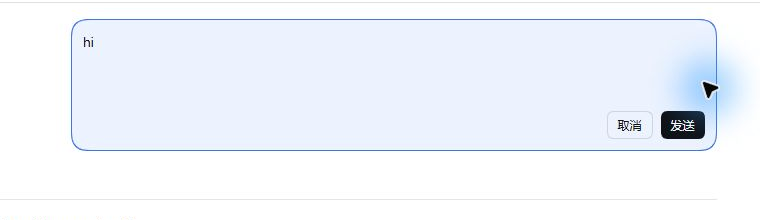
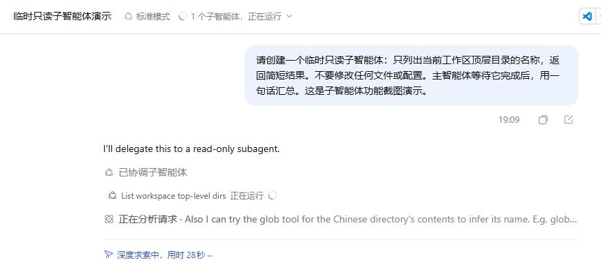
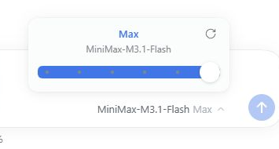
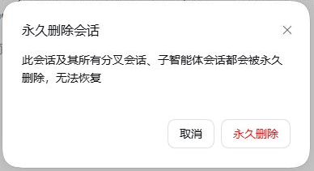

# DeepSeek Harness

English | [中文](README.zh.md)

**An agent workbench with the human in the loop.**

This independent edition of [DeepSeek Harness](https://github.com/deepseek-ai/deepseek-harness) focuses on the desktop experience: make agent work visible, give people precise controls, and keep conversations easy to revisit. DeepSeek AI created the upstream project; this repository is independently maintained.

It is built on an **everything-is-a-plugin** architecture and powered by [Cordis](https://github.com/cordiverse/cordis), whose design is described in [_A Programming Paradigm for Spatiotemporal Composability_](https://arxiv.org/abs/2608.25512).

The plugin architecture remains the foundation. The interface adds editable recent messages, adjustable reasoning effort for supported models, session summaries, permanent session deletion, and visible subagent progress.

## Desktop experience

| Steer the conversation | See delegated work |
| --- | --- |
|  |  |
|  |  |

The screenshots show the current desktop development build. The [user guides](docs/user/index.md) cover the underlying Harness features.

## Developer preview

This edition is in _developer preview_ and may make compatibility-breaking changes.

Review the [safety notice](SAFETY.md) before running the project.

## Run

<a id="run-from-source"></a>

### Desktop from source

Install a supported Node.js version and Corepack-enabled pnpm, then run:

```sh
git clone https://github.com/midnight-automaton/deepseek-harness.git
cd deepseek-harness
pnpm install
pnpm run build:artifacts
pnpm run start:desktop
```

`start:desktop` launches the development application; it does not create an installer. For the Web UI, use `pnpm dsh web` after the artifact build and follow the [Web UI guide](docs/user/guide/index.md). The published `@deepseek-ai/dsh` npm package belongs to the upstream project and does not include this edition's desktop changes.

## Community and support

- Report bugs or propose improvements in this repository's [Issues](https://github.com/midnight-automaton/deepseek-harness/issues).
- Visit the [upstream repository](https://github.com/deepseek-ai/deepseek-harness) for the original project and its community.

## Contributing

Issues and pull requests are welcome; see [CONTRIBUTING.md](CONTRIBUTING.md).

## Development

Start with the [development guide](docs/development.md) and [architecture documentation](docs/architecture.md).

`pnpm run dev:web` builds, serves, and rebuilds client bundles on source edits in one terminal, and `make help` lists the matching Make targets for Web and Desktop; the guide's application commands section owns the full table.

For agents, follow [AGENTS.md](AGENTS.md).

## Citation

```bibtex
@misc{deepseek-harness2026,
  title={DeepSeek Harness: Everything is a Plugin},
  author={DeepSeek-AI},
  year={2026},
  publisher={GitHub},
  howpublished={\url{https://github.com/deepseek-ai/deepseek-harness}},
}
```

## License

[MIT](LICENSE)

Third-party dependencies and their licenses are disclosed in [THIRD_PARTY_NOTICES.md](THIRD_PARTY_NOTICES.md).
